# PetMate 宠物综合服务系统 — 产品需求文档（PRD）

> **文档版本**：v1.0
> **编写日期**：2026-07-17
> **作者角色**：产品经理
> **目标读者**：项目作者、毕业论文答辩评委、参与编码的同学
> **项目名**：PetMate（宠物伴侣）
> **技术栈**：Spring Boot 3 + Vue 3 + TypeScript + MySQL 8 + Redis 7

---

## 目录

- [0. PRD 总览](#0-prd-总览)
- [1. 产品概述](#1-产品概述)
- [2. 角色与权限矩阵](#2-角色与权限矩阵)
- [3. 功能模块拆解](#3-功能模块拆解)
- [4. 用户旅程地图](#4-用户旅程地图)
- [5. 信息架构与页面清单](#5-信息架构与页面清单)
- [6. 数据库设计](#6-数据库设计)
- [7. API 接口规约](#7-api-接口规约)
- [8. 推荐系统设计（论文亮点）](#8-推荐系统设计论文亮点)
- [9. AI 智能问诊设计（论文亮点）](#9-ai-智能问诊设计论文亮点)
- [10. 非功能性需求](#10-非功能性需求)
- [11. 技术选型与架构图](#11-技术选型与架构图)
- [12. 里程碑与 WBS](#12-里程碑与-wbs)
- [13. 论文-章节对照表](#13-论文-章节对照表)

---

## 0. PRD 总览

### 0.1 项目背景

随着都市独居、晚婚晚育率上升，宠物已成为重要的家庭成员。中国宠物消费市场规模超 3000 亿元，年增长率约 15%。但市面上宠物服务普遍存在以下痛点：

- **分散**：买粮去波奇、看病去新瑞鹏、寄养找闲鱼，用户需要在 5+ 个 App 间切换
- **不专业**：社区内容良莠不齐，缺乏结构化知识
- **缺陪伴**：新手宠物主深夜遇到宠物突发状况找不到人问
- **触达弱**：宠物门店获客依赖点评与线下，缺乏数字化工具

### 0.2 产品愿景

**让每一个毛孩子都被科学、有爱地对待；让宠物主的一站式需求 5 分钟内被满足。**

PetMate 通过整合商品、服务、社区、知识、AI 健康陪伴，让宠物主在一个 App 内完成所有与「养好一只宠物」相关的事。

### 0.3 核心产品决策（已确认）

| 维度 | 决策 |
| --- | --- |
| 核心定位 | 综合生活服务平台（一站式） |
| 角色体系 | 普通用户 / 商家 / 平台管理员（医生问诊用 AI 替代） |
| 端形态 | **纯浏览器 Web 端** + **响应式适配手机浏览器**（用户端） |
| 适配策略 | 用户端响应式（桌面优先 / 平板 / 手机三档断点）；商家端 PC 为主可读不可编辑；管理后台仅 PC |
| 适配方案 | PostCSS `postcss-px-to-viewport`，设计稿按 1920px，输出 `vw` 单位 |
| 技术亮点 | 推荐 / 个性化算法（UserCF + ItemCF + 内容画像） |
| 前端栈 | Vue 3 + Vite + TypeScript + Element Plus + postcss-px-to-viewport |
| 后端栈 | Spring Boot 3.3.x + **JDK 21 LTS** + MyBatis-Plus + Sa-Token + MySQL 8 + Redis 7 |

### 0.4 关键差异化亮点（答辩卖点）

| 编号 | 亮点 | 论文对应章节 |
| --- | --- | --- |
| ★1 | 基于协同过滤的个性化推荐引擎 | 第 6 章 6.2 推荐系统实现 |
| ★2 | LLM 驱动的宠物 AI 智能问诊 | 第 6 章 6.3 AI 问诊实现 |
| ★3 | 一站式业务覆盖（商城+服务+社区+内容+营销） | 第 4 章 总体设计 |
| ★4 | RBAC + Sa-Token 权限中台 | 第 5 章 5.4 安全设计 |
| ★5 | ECharts 数据大屏 + 多维度统计 | 第 6 章 6.5 数据可视化 |
| ★6 | Docker + Nginx 一键部署 | 第 8 章 总结与展望 |
| ★7 | **响应式 Web 端（PC + 移动浏览器自适应）**，一套 Vue 代码覆盖三端 | 第 4 章 总体设计 |

### 0.5 文档用途

- 直接作为毕业论文「需求分析」「总体设计」「数据库设计」「详细设计与实现」四章的事实来源
- 作为后续编码的契约，约束模块、字段、接口形态
- 作为组内 / 评委的快速索引

---

## 1. 产品概述

### 1.1 产品愿景

PetMate 致力于构建一个**「宠物 + 人 + 服务」三方共赢**的数字生态：

- **对宠物主**：从「养宠焦虑」变为「轻松陪伴」，遇到问题 5 分钟内能在 PetMate 内得到帮助
- **对商家**：从「等客上门」变为「数据驱动」，获得持续曝光与精准订单
- **对平台**：通过推荐算法与 AI 问诊构筑差异化壁垒，避免与纯电商的直接价格战

### 1.2 目标用户细分

| 用户分群 | 占比假设 | 核心场景 | 关键需求 |
| --- | --- | --- | --- |
| **都市年轻宠主（主力）** 22-35 岁 | 60% | 上下班通勤、深夜突发、节假日 | 便捷购药、AI 问诊、社区分享 |
| **新手宠主** | 20% | 第一只宠物、知识空白 | 系统化科普、训练课、疫苗提醒 |
| **多宠家庭** | 10% | 2 只以上猫狗异宠 | 多宠物档案、批量寄养 |
| **商家端（宠物门店/医院/寄养家庭）** | 8% | 接单、客户运营、数据复盘 | 数字化工作台、营销工具 |
| **平台运营 / 客服** | 2% | 内容审核、风控、活动配置 | 管理后台 + 数据看板 |

### 1.3 核心价值主张

1. **一站式购物**：食品、用品、药品、玩具、服饰一次购齐，免跨平台切换
2. **专业服务直约**：美容、训练、寄养、遛狗师均可在线挑选、比价、预约
3. **AI 7×24 健康陪伴**：基于大模型的宠物 AI 健康师，紧急时给方向、平时给科普
4. **同好社区**：刷动态、晒萌照、学经验，形成情感黏性
5. **数据推荐**：千人千面 feed，懂「你」的宠物

### 1.4 名词解释

| 术语 | 定义 |
| --- | --- |
| **SKU** | Stock Keeping Unit，最小销售单位（例如「渴望鸡肉猫粮 1kg」是一个 SKU） |
| **SPU** | Standard Product Unit，标准化产品单元（同款商品不同规格聚合） |
| **服务项** | 商家提供的非实物商品（如「洗澡小卡」「30 天寄养」） |
| **预约单** | 用户对某项服务的时间段预约记录 |
| **问诊会话** | 一段连续的多轮 AI 问答，对应一个 `consultation_id` |
| **推荐 feed** | 首页千人千面的内容流，混合图文 / 商品 / 服务 |
| **AI 健康师** | 基于大模型的虚拟角色，负责健康问答 |
| **成长日记** | 用户为宠物记录体重、驱虫、疫苗等时间线数据 |
| **社区贴 / 动态** | 用户发布的图文 / 短视频内容 |

---

## 2. 角色与权限矩阵

### 2.1 角色模型

PetMate 采用 **三顶层 + 八子类** 的 RBAC 角色模型，简洁清晰且能覆盖业务全场景：

| 顶层 | 子账户 | 说明 |
| --- | --- | --- |
| **USER（普通用户）** | 游客 | 未登录浏览，限制写操作 |
| | 注册用户 | 默认 |
| | VIP 用户 | 年消费 ≥ 2000 元或购买会员，享折扣与专属客服 |
| **MERCHANT（商家）** | 店长 | 商家主账号，所有权限 |
| | 店员 | 处理订单、上架商品 |
| | 医生 | （已废除，本系统不招医生） |
| | 技师 | 美容 / 训练服务提供者 |
| **ADMIN（平台管理员）** | 运营 | 配置 banner、活动、内容审核 |
| | 客服 | 处理退款、举报、纠纷 |
| | 财务 | 结算、账单查看 |
| | 超管 | 一切权限，包含角色分配 |

> **设计取舍**：用户原始意向是引入「医生」第四类角色。经评估，引入医生角色需要资质审核、问诊合规备案、医责边界等额外复杂度，**毕业设计阶段用「AI 智能问诊」替代医生功能**，降低角色复杂度的同时强化 AI 亮点。

### 2.2 权限矩阵（节选）

> **R** = 只读 · **W** = 可写 · **X** = 仅自己数据可见 · **NA** = 无权限

| 功能域 | 游客 | 注册用户 | VIP | 店长 | 店员 | 技师 | 运营 | 客服 | 财务 | 超管 |
| --- | --- | --- | --- | --- | --- | --- | --- | --- | --- | --- |
| 浏览商品 / 服务 | R | R | R | R | R | R | R | R | R | R |
| 下单 / 支付 | NA | W | W（折扣） | X | X | NA | X | X | NA | X |
| 发起 AI 问诊 | NA | W（限频） | W（高配额） | NA | NA | NA | NA | NA | NA | NA |
| 发布社区贴 | NA | W | W | NA | NA | NA | NA | NA | NA | NA |
| 商家商品上下架 | NA | NA | NA | W | W | NA | NA | NA | NA | W |
| 商家接单 | NA | NA | NA | W | W | W（自己预约单） | NA | NA | NA | W |
| 平台内容审核 | NA | NA | NA | NA | NA | NA | W | X | NA | W |
| 退款处理 | NA | NA | NA | X | NA | NA | NA | W | NA | W |
| 结算账单查看 | NA | NA | NA | X | NA | NA | NA | NA | W | W |
| 角色分配 | NA | NA | NA | NA | NA | NA | NA | NA | NA | W |

完整矩阵在编码阶段通过 `role_permission` 表持久化。

### 2.3 鉴权机制

- 登录后服务端签发 Sa-Token，前端每次请求携带 `Authorization: Bearer {token}`
- 头部附加 `X-Role: USER/MERCHANT/ADMIN`、`X-Store-Id: {merchant 子账号携带}`
- Sa-Token 拦截器对每个 `@SaCheckRole("MERCHANT")` 注解自动校验
- 商家端管理路径以 `/merchant/**` 前缀区分用户端 `/api/**`
- 管理后台路径以 `/admin/**` 前缀且仅允许内网 IP + 二次鉴权

---

## 3. 功能模块拆解

PetMate 包含 **15 个一级模块**，按业务纵深排列：

### 3.1 用户中心

- **3.1.1 注册 / 登录**
  - 手机号 + 短信验证码（模拟环境固定返回 123456）
  - 微信 OAuth2.0（扫码登录，便于论文演示）
  - 密码登录（账号密码登录兜底）
  - 自动续签：Sa-Token 设置有效期 7 天，活跃滑动续期
- **3.1.2 个人资料**
  - 头像（AI 卡通头像生成，调 5 次免费，后面要付费，便于商业化故事）
  - 昵称、性别、生日、地区、个性签名
- **3.1.3 收货地址**
  - 增删改查 + 默认地址
  - 调腾讯位置服务解析为省/市/区三级
- **3.1.4 会员等级**
  - 等级 V0-V5，按近 12 个月消费额升级
  - 等级权益：折扣、专属客服、问诊配额翻倍

**验收标准**：注册全流程 ≤ 60s；登录接口 P95 < 200ms；地址簿支持批量导入。

### 3.2 宠物档案

- **3.2.1 多宠物管理**：一只用户可绑定 N 只宠物，每只独立档案
- **3.2.2 品种字典**：预置 200+ 标准品种（猫、狗、兔、仓鼠、异宠），可扩展
- **3.2.3 健康档案**：体重、疫苗、驱虫、体检、病史时间线
- **3.2.4 成长日记**：图片 + 文字流，支持心情、标签、纪念日
- **3.2.5 智能提醒**：疫苗到期前 7 天、驱虫周期、年度体检 App 内推送

**验收标准**：档案添加 ≤ 5 步；成长日记支持图片 ≥ 9 张；推送准时率 ≥ 95%。

### 3.3 商品商城

- **3.3.1 分类树**：3 级分类（食品/用品/医疗/服饰）
- **3.3.2 商品详情**：富文本详情 + 用户评价 + 同款商品 + 推荐位
- **3.3.3 商品搜索**：Elasticsearch 全文检索 + 关键词高亮 + 聚合筛选
- **3.3.4 评价系统**：图片 + 文字 + 评分 1-5 星 + 商家回复
- **3.3.5 收藏 / 足迹**：用户行为日志，用于推荐召回

**验收标准**：搜索响应 P95 < 400ms；详情页首屏 < 1.5s（首屏 SSR 缓存）。

### 3.4 购物车与订单

- **3.4.1 购物车**：登录态持久化 Redis，游客态 LocalStorage
- **3.4.2 下单流程**：地址确认 → 优惠券选择 → 支付方式 → 提交
- **3.4.3 订单状态机**：

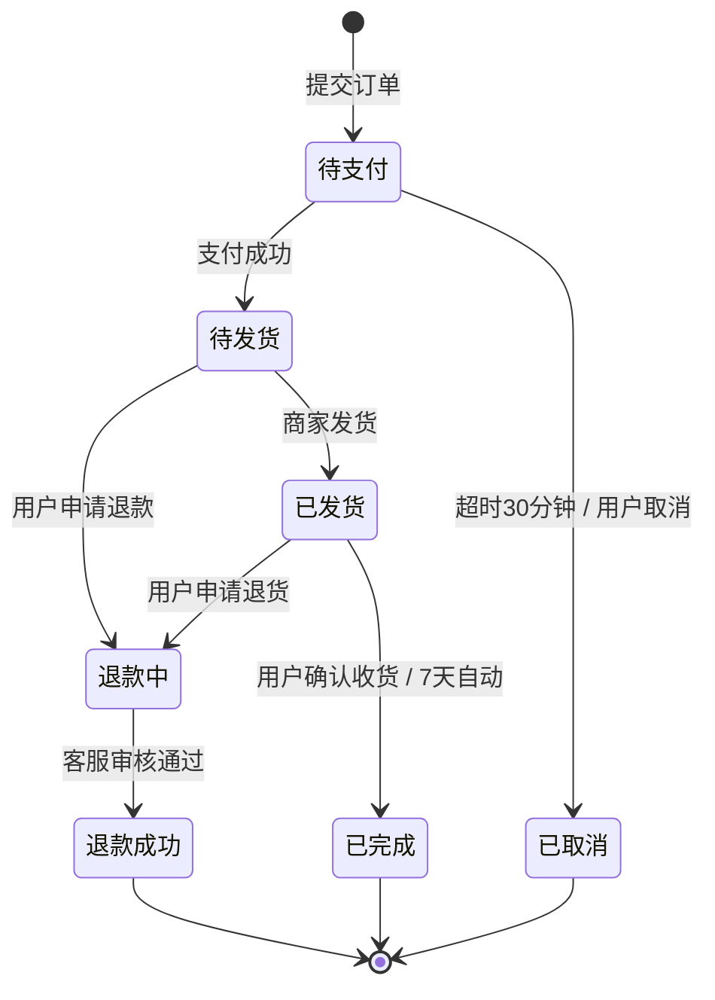

- **3.4.4 发票**：可申请电子发票，记录税号与抬头

### 3.5 支付与钱包

- **3.5.1 支付方式**：微信支付沙箱、支付宝沙箱、平台余额（模拟）
- **3.5.2 优惠券**：满减 / 折扣 / 品类券，领券中心 + 主动发券
- **3.5.3 余额充值**：模拟充值（毕业设计不上真实支付）
- **3.5.4 退款**：原路退回，余额部分即时退

**验收标准**：支付回调幂等 100%；优惠券核销 0 资损。

### 3.6 AI 智能问诊（★亮点）

详尽设计见 [第 9 章](#9-ai-智能问诊设计论文亮点)

- 入口：首页悬浮按钮 + 宠物档案页「问健康」
- 形态：多轮对话，类似 ChatGPT 的聊天气泡
- 输入：文字 + 语音（科大讯飞 ASR 沙箱）+ 图片（支持拍照上传体征照片）
- 输出：分级建议（紧急 / 建议就医 / 日常照护）+ 关联商品推荐 + 转人工兜底

### 3.7 美容洗护与训练课程

- **3.7.1 美容洗护**：选择门店 / 技师 / 套餐 / 时段
- **3.7.2 训练课程**：视频课（点播） + 1v1 私教（按课时）
- **3.7.3 上门 vs 到店**：到店为主，上门为辅，地图选点

### 3.8 寄养托管

- **3.8.1 家庭寄养 vs 宠物店寄养**：双模式
- **3.8.2 寄养家庭展示**：实景图片、视频、评价、价格
- **3.8.3 寄养期间**：每日签到（视频打卡）+ 实时位置（受邀可见）
- **3.8.4 接回流程**：签离 → 评价 → 平台抽佣结算

### 3.9 社区动态

- **3.9.1 发布**：图文 / 短视频（≤ 30s）/ 话题标签 / @好友
- **3.9.2 互动**：点赞、评论、收藏、分享、关注
- **3.9.3 推荐**：首页 feed、宠物匹配、热门话题榜
- **3.9.4 审核**：AI 初审 + 人工抽审，涉黄涉政屏蔽

### 3.10 领养救助

- **3.10.1 送养信息**：免费发布，需平台审核
- **3.10.2 领养协议**：在线签字（留存电子签名）
- **3.10.3 回访**：领养后 7/30/90 天自动推送回访问卷

### 3.11 知识科普

- **3.11.1 CMS**：后台富文本编辑 + 多媒体
- **3.11.2 分类**：按宠物种类 + 主题（健康 / 喂养 / 行为 / 心理）
- **3.11.3 SEO 友好 URL**：例如 `/knowledge/cat/health/vaccine`
- **3.11.4 收藏与点赞**：行为日志回流推荐系统

### 3.12 营销活动

- **3.12.1 限时秒杀**：Redis 原子扣减 + 分布式锁
- **3.12.2 拼团**：2-N 人成团，超时退款
- **3.12.3 积分商城**：积分换小样
- **3.12.4 节日活动**：春节、618、双 11 主题弹窗 + banner

### 3.13 服务商后台

- **3.13.1 工作台**：实时订单、待办、日销售
- **3.13.2 商品管理**：上下架、库存调拨
- **3.13.3 服务管理**：排班、时段、价格
- **3.13.4 订单处理**：发货、确认、核销
- **3.13.5 评价管理**：回复、申诉
- **3.13.6 数据看板**：销售、客流、转化

### 3.14 运营管理后台

- **3.14.1 仪表盘**：核心指标 ECharts 大屏
- **3.14.2 用户管理**：列表 / 详情 / 封禁
- **3.14.3 商品 / 订单**：全链路管理
- **3.14.4 内容审核**：社区、知识、领养
- **3.14.5 举报与风控**：敏感词、ip 黑名单
- **3.14.6 权限管理**：角色、权限、菜单
- **3.14.7 系统配置**：字典、参数、首页布局

### 3.15 推荐系统（★亮点）

详尽设计见 [第 8 章](#8-推荐系统设计论文亮点)

- 首页 feed 千人千面
- 详情页「看了又看」「买了又买」「相似推荐」
- 服务页「附近 + 兴趣加权」

---

## 4. 用户旅程地图

> 用 6 条主线 + 1 条情感曲线串起 15 个模块的核心链路，可直接复制到论文作图。

### 4.1 主线 A：购物流程

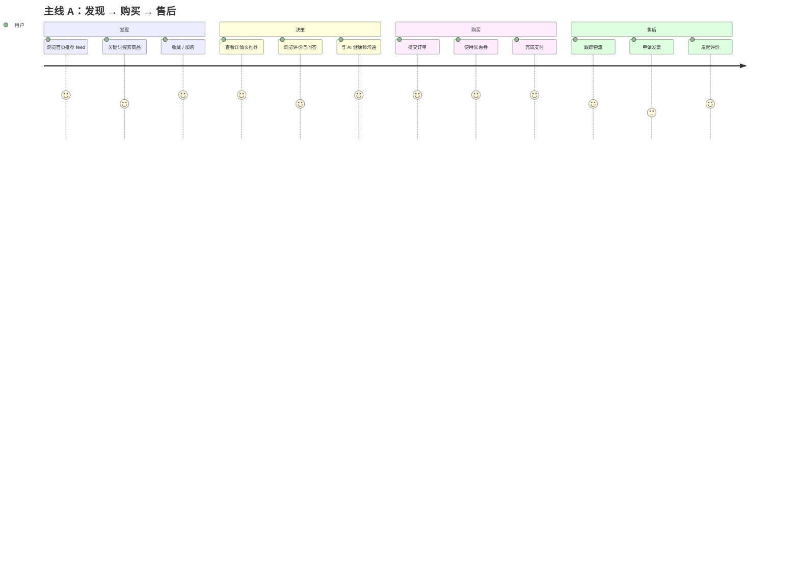

### 4.2 主线 B：AI 健康问诊 → 购药

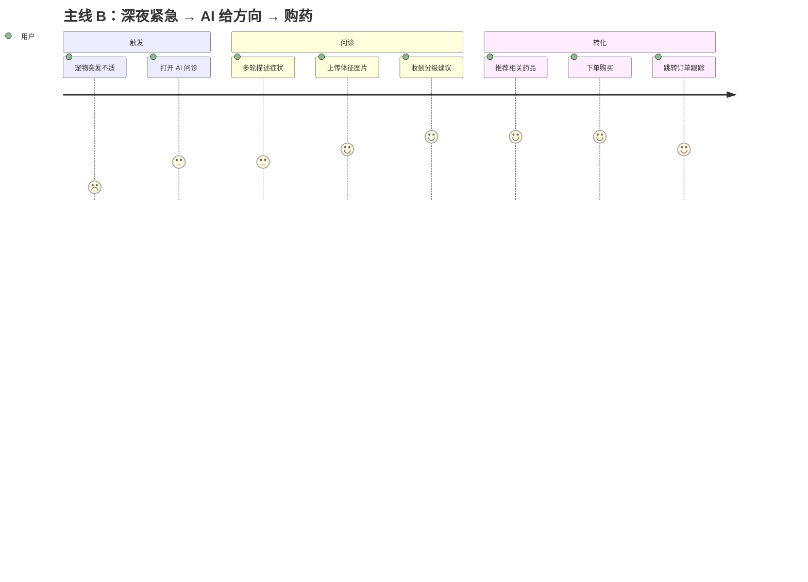

### 4.3 主线 C：节假日寄养

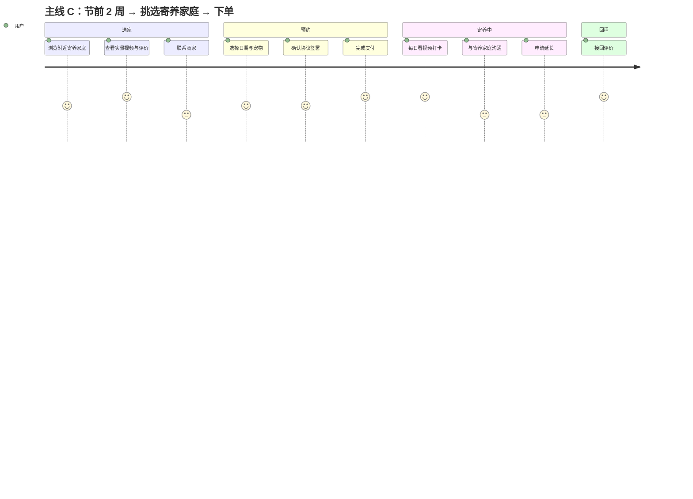

### 4.4 主线 D：商家入驻

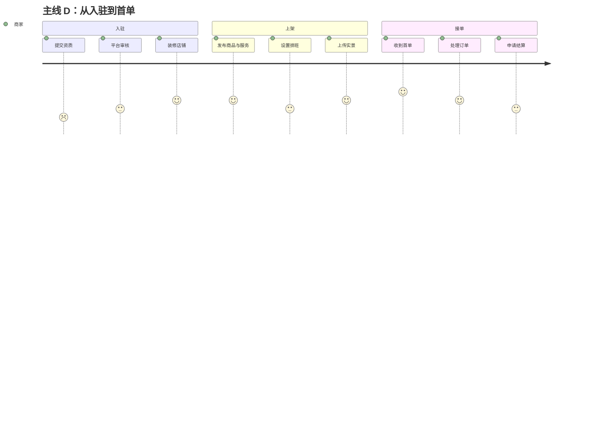

### 4.5 主线 E：内容生产与消费

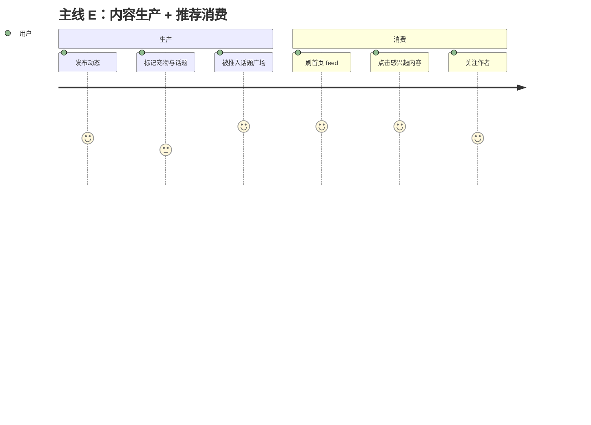

### 4.6 主线 F：冷启动与召回

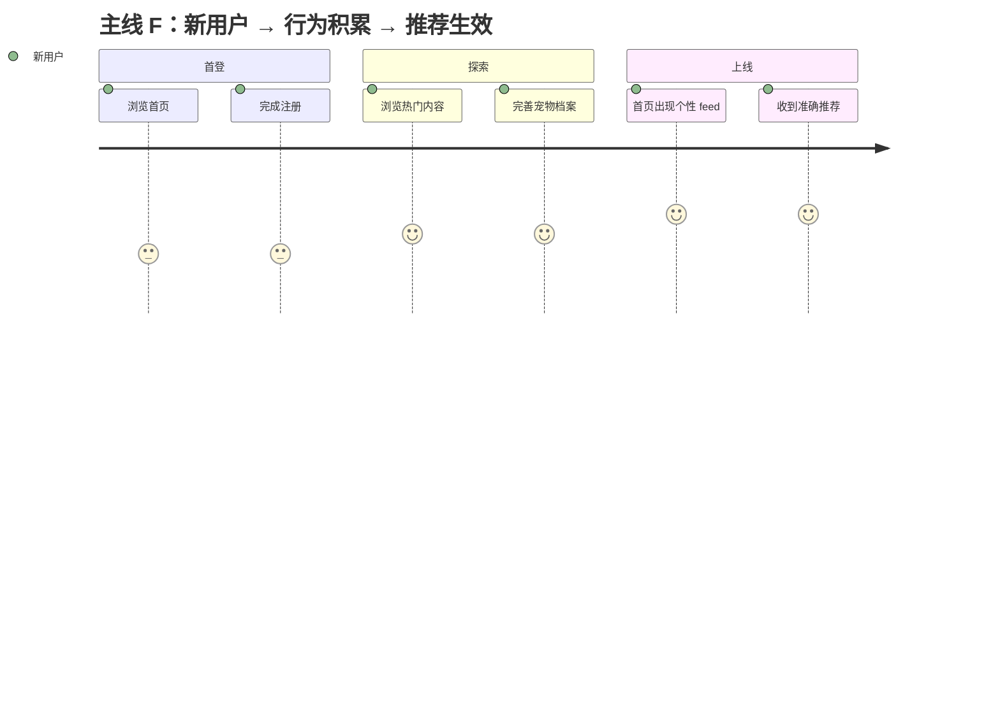

---

## 5. 信息架构与页面清单

### 5.0 端形态与响应式策略（关键）

PetMate 是 **纯浏览器 Web 端**，不开发原生 App。所有端访问入口唯一：`https://petmate.example.com`。

| 端 | 形态 | 适配策略 |
| --- | --- | --- |
| **用户端** | 响应式 Web（**桌面优先 + 移动浏览器自适应**） | 一套 Vue 代码，三档断点 + vw 适配 |
| **商家端** | PC 为主，手机浏览器**仅可阅读、不可编辑** | 移动端隐藏复杂表单，仅展示 |
| **管理后台** | **仅 PC**（≥1280px 优化），手机访问提示「请使用桌面浏览器」 | 通过 UA 判断 + 视口宽度判断 |

#### 5.0.1 响应式断点与布局规则

| 断点 | 视口宽度 | 形态描述 | 典型设备 |
| --- | --- | --- | --- |
| **桌面** | ≥1024px | 3-4 列布局、顶栏 + 侧栏 + 内容区、宽屏居中 | PC、笔记本 |
| **平板** | 768~1024px | 2 列布局、收起侧栏到顶部抽屉、字号/图标略缩 | iPad、Android 平板 |
| **手机** | ≤768px | 单列瀑布流、底部 Tab 栏、抽屉式菜单、列表/卡片堆叠 | 手机浏览器、PWA |

#### 5.0.2 技术实现

- **方案**：PostCSS + `postcss-px-to-viewport` 插件
- **设计稿**：按 **1920px** 宽度做设计稿，CSS 全部用 `px`，构建时按 `100vw = 1920px`（视口宽度）等比缩放到 `vw`
- **特殊元素**：1px 边框使用 `transform: scaleY(0.5)` + `@media (-webkit-min-device-pixel-ratio: 2)` 处理
- **顶部导航**：桌面为水平导航；≤768px 时收起为左上角汉堡按钮 + 抽屉
- **底部 Tab 栏**：仅 ≤768px 出现，桌面不显示
- **图片**：使用 `loading="lazy"` + `srcset` 多倍图 + `object-fit: cover`

#### 5.0.3 关键页面策略

| 页面 | 桌面 | 平板 | 手机 |
| --- | --- | --- | --- |
| 首页 feed | 4 列瀑布流 | 3 列 | 1 列 + 顶部 banner |
| 商品列表 | 4 列卡片 + 左侧类目筛选 | 3 列 + 顶部筛选 | 2 列 + 顶部下拉筛选 |
| 商品详情 | 左图右文 6:6 | 上图下文 | 上图下文全屏图 |
| AI 问诊室 | 居中 800px 双栏 | 居中 720px | 全屏沉浸 |
| 购物车 | 表格列表 | 卡片列表 | 卡片列表 + 底部结算栏 |
| 个人中心 | 左右布局 | 上下布局 | 上下 + 头像居中 |
| 商家工作台 | 4 个 KPI 卡 + 12 列图表 | 4 个 KPI + 12 列 | 不可用 |
| 管理后台 | 完整后台布局 | 不可用 | 显示「请使用桌面浏览器」提示页 |

#### 5.0.4 触控与移动浏览器兼容

- 按钮最小点击区域 **44×44px**（苹果 HIG 标准）
- 长列表使用 `-webkit-overflow-scrolling: touch` 平滑滚动
- 移动端表单输入框 `font-size ≥ 16px` 防止 iOS 自动放大
- 支持横竖屏自适应（横屏减少一列）
- 兼容 **iOS Safari 14+**、**Android Chrome 90+**、**微信内置浏览器**（不开新窗口，避免被拦截）
- 主色与品牌色保持 WCAG 2.1 AA 对比度
- 表单 `keyboard` 类型按场景选择 `numeric` / `email` / `tel` / `text`

### 5.1 用户端（30 个页面）

| 编号 | 路由 | 页面 | 关键组件 | 关键接口 |
| --- | --- | --- | --- | --- |
| P01 | `/` | 首页 feed | FeedList / Banner / TabBar | `GET /api/v1/recommend/feed` |
| P02 | `/category` | 分类 | CategoryTree / SubFilter | `GET /api/v1/category/tree` |
| P03 | `/search` | 搜索 | SearchBar / HotKey / ResultList | `GET /api/v1/search` |
| P04 | `/product/:id` | 商品详情 | Gallery / SkuSelect / Recommend | `GET /api/v1/product/{id}` |
| P05 | `/service/:id` | 服务详情 | PackageSelect / StoreMap / Recommend | `GET /api/v1/service/{id}` |
| P06 | `/cart` | 购物车 | CartList / Coupon | `GET /api/v1/cart` |
| P07 | `/checkout` | 结算 | AddressPicker / CouponPicker / PayWay | `POST /api/v1/order` |
| P08 | `/pay/:orderNo` | 支付 | PayTimer / PayWay | `POST /api/v1/pay/{orderNo}` |
| P09 | `/pet/list` | 宠物列表 | PetCard | `GET /api/v1/pet/list` |
| P10 | `/pet/edit/:id` | 宠物编辑 | Form / BreedPicker | `POST /api/v1/pet` |
| P11 | `/pet/health/:id` | 健康档案 | Timeline | `GET /api/v1/pet/{id}/health` |
| P12 | `/consult` | AI 问诊室 | ChatList / Input | `POST /api/v1/consult/send` |
| P13 | `/consult/history` | 问诊记录 | List | `GET /api/v1/consult/list` |
| P14 | `/appointments` | 我的预约 | Tabs (美容 / 训练 / 寄养) | `GET /api/v1/appointment/list` |
| P15 | `/appointment/booking/:id` | 预约下单 | DatePicker / StorePicker | `POST /api/v1/appointment` |
| P16 | `/community` | 社区首页 | TopicTab / FeedCard | `GET /api/v1/community/feed` |
| P17 | `/community/post/:id` | 帖子详情 | CommentList / LikeBtn | `GET /api/v1/post/{id}` |
| P18 | `/community/publish` | 发布动态 | Editor / TagPicker | `POST /api/v1/post` |
| P19 | `/knowledge` | 知识科普 | Category / ArticleList | `GET /api/v1/article/list` |
| P20 | `/knowledge/:id` | 文章详情 | RichText | `GET /api/v1/article/{id}` |
| P21 | `/adoption` | 领养列表 | PetCard / Filter | `GET /api/v1/adoption/list` |
| P22 | `/adoption/detail/:id` | 领养详情 | Gallery / Application | `POST /api/v1/adoption/apply` |
| P23 | `/coupon-center` | 领券中心 | CouponList / ClaimBtn | `POST /api/v1/coupon/claim` |
| P24 | `/seckill` | 秒杀页 | Countdown / ProductGrid | `GET /api/v1/seckill/list` |
| P25 | `/order/list` | 我的订单 | StatusTabs | `GET /api/v1/order/list` |
| P26 | `/order/detail/:id` | 订单详情 | Step / Address / PayInfo | `GET /api/v1/order/{id}` |
| P27 | `/user` | 我的 | Avatar / Grid / VIP Card | `GET /api/v1/user/me` |
| P28 | `/user/address` | 地址簿 | List / Editor | `GET /api/v1/user/address` |
| P29 | `/user/collect` | 我的收藏 | Tabs | `GET /api/v1/favorite/list` |
| P30 | `/login` `/register` | 登录注册 | Tabs / WxBtn | `POST /api/v1/auth/login` |

### 5.2 商家端（16 个页面）

| 编号 | 路由 | 页面 | 关键接口 |
| --- | --- | --- | --- |
| M01 | `/merchant/dashboard` | 工作台 | `GET /api/v1/merchant/dashboard` |
| M02 | `/merchant/order` | 订单管理 | `GET /api/v1/merchant/order/list` |
| M03 | `/merchant/order/:id` | 订单详情 | `GET /api/v1/merchant/order/{id}` |
| M04 | `/merchant/product/list` | 商品管理 | `GET /api/v1/merchant/product/list` |
| M05 | `/merchant/product/edit` | 商品编辑 | `POST /api/v1/merchant/product` |
| M06 | `/merchant/service/list` | 服务管理 | `GET /api/v1/merchant/service/list` |
| M07 | `/merchant/service/edit` | 服务编辑 | `POST /api/v1/merchant/service` |
| M08 | `/merchant/schedule` | 排班管理 | `GET /api/v1/merchant/schedule` |
| M09 | `/merchant/review` | 评价管理 | `GET /api/v1/merchant/review` |
| M10 | `/merchant/store/info` | 门店信息 | `GET /api/v1/merchant/store` |
| M11 | `/merchant/store/photos` | 实景相册 | `POST /api/v1/merchant/store/photos` |
| M12 | `/merchant/data/sales` | 销售看板 | `GET /api/v1/merchant/data/sales` |
| M13 | `/merchant/data/visitor` | 客流分析 | `GET /api/v1/merchant/data/visitor` |
| M14 | `/merchant/data/convert` | 转化漏斗 | `GET /api/v1/merchant/data/convert` |
| M15 | `/merchant/finance` | 财务结算 | `GET /api/v1/merchant/finance` |
| M16 | `/merchant/settings` | 商家设置 | `GET /api/v1/merchant/settings` |

### 5.3 管理后台（22 个页面）

| 编号 | 路由 | 页面 | 关键接口 |
| --- | --- | --- | --- |
| A01 | `/admin/dashboard` | 运营仪表盘（ECharts 大屏） | `GET /api/v1/admin/dashboard` |
| A02 | `/admin/user/list` | 用户管理 | `GET /api/v1/admin/user/list` |
| A03 | `/admin/user/detail/:id` | 用户详情 | `GET /api/v1/admin/user/{id}` |
| A04 | `/admin/merchant/list` | 商家管理 | `GET /api/v1/admin/merchant/list` |
| A05 | `/admin/merchant/audit` | 商家审核 | `POST /api/v1/admin/merchant/audit` |
| A06 | `/admin/product/list` | 商品管理 | `GET /api/v1/admin/product/list` |
| A07 | `/admin/product/category` | 分类管理 | `POST /api/v1/admin/category` |
| A08 | `/admin/order/list` | 订单管理 | `GET /api/v1/admin/order/list` |
| A09 | `/admin/order/refund` | 退款审核 | `POST /api/v1/admin/order/refund` |
| A10 | `/admin/community/post` | 帖子审核 | `GET /api/v1/admin/post/audit` |
| A11 | `/admin/community/report` | 举报处理 | `GET /api/v1/admin/report/list` |
| A12 | `/admin/article/list` | 知识文章 | `GET /api/v1/admin/article/list` |
| A13 | `/admin/adoption/audit` | 领养审核 | `GET /api/v1/admin/adoption/audit` |
| A14 | `/admin/marketing/seckill` | 秒杀配置 | `POST /api/v1/admin/seckill` |
| A15 | `/admin/marketing/coupon` | 优惠券配置 | `POST /api/v1/admin/coupon` |
| A16 | `/admin/content/banner` | 首页 Banner | `POST /api/v1/admin/banner` |
| A17 | `/admin/risk/sensitive` | 敏感词管理 | `POST /api/v1/admin/sensitive` |
| A18 | `/admin/risk/blacklist` | 黑名单 | `POST /api/v1/admin/blacklist` |
| A19 | `/admin/role/list` | 角色管理 | `GET /api/v1/admin/role/list` |
| A20 | `/admin/role/permission` | 权限分配 | `POST /api/v1/admin/role/permission` |
| A21 | `/admin/system/config` | 系统参数 | `GET /api/v1/admin/config` |
| A22 | `/admin/system/log` | 操作日志 | `GET /api/v1/admin/log` |

合计 **68 个页面**，三大端共享 Element Plus 组件库，保证视觉统一。

### 5.4 组件分层（前端）

```
src/
├── views/         # 页面
├── components/    # 通用组件（ProductCard / PetAvatar / ...)
├── composables/   # Composition API 抽象（useRequest / useFetch / useUser）
├── stores/        # Pinia 全局状态（userStore / cartStore）
├── router/        # 路由配置 + 守卫
├── api/           # axios 二次封装 + 各模块 API
├── utils/         # 工具（auth / storage / format）
└── types/         # TypeScript 类型定义
```

---

## 6. 数据库设计

### 6.1 数据库选型与命名

- **DBMS**：MySQL 8.0（utf8mb4 / utf8mb4_unicode_ci）
- **命名规范**：表名 `t_xxx`、主键 `id`、外键 `{table}_id`、索引 `idx_xxx`、唯一约束 `uk_xxx`
- **设计原则**：逻辑删除 `is_deleted` + 时间戳 `created_at` `updated_at`

### 6.2 ER 总览

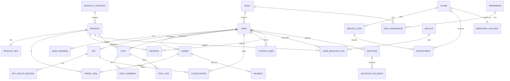

### 6.3 核心表设计

#### 6.3.1 用户域

**`t_user` 用户表**

| 字段 | 类型 | 注释 |
| --- | --- | --- |
| id | BIGINT PK | 主键 |
| open_id | VARCHAR(64) | 微信 openId |
| phone | VARCHAR(20) | 手机号 |
| nickname | VARCHAR(64) | 昵称 |
| avatar | VARCHAR(255) | 头像 URL |
| gender | TINYINT | 0未知/1男/2女 |
| birthday | DATE | 生日 |
| vip_level | TINYINT | 0-5 |
| status | TINYINT | 0正常/1封禁/2注销 |
| last_login_at | DATETIME | 最近登录 |
| created_at / updated_at | DATETIME | |
| is_deleted | TINYINT | 逻辑删除 |
| **索引** | `uk_phone` `uk_open_id` `idx_vip_level` | |

**`t_user_address` 收货地址**

| 字段 | 类型 | 注释 |
| --- | --- | --- |
| id | BIGINT PK | |
| user_id | BIGINT FK | |
| receiver | VARCHAR(64) | |
| phone | VARCHAR(20) | |
| province / city / district | VARCHAR(32) | |
| detail | VARCHAR(255) | |
| is_default | TINYINT | 默认地址 |
| tag | VARCHAR(32) | 家/公司/学校 |
| **索引** | `idx_user_id` | |

**`t_role` / `t_permission` / `t_role_permission` / `t_user_role`**

RBAC 标准 4 表，详见 2.2 权限矩阵的物理化。

#### 6.3.2 宠物域

**`t_pet` 宠物档案**

| 字段 | 类型 | 注释 |
| --- | --- | --- |
| id | BIGINT PK | |
| user_id | BIGINT FK | 主人 |
| name | VARCHAR(64) | 名字 |
| category_id | BIGINT FK | 种类 |
| breed_id | BIGINT FK | 品种 |
| gender | TINYINT | 0公/1母/2未知 |
| birthday | DATE | |
| weight | DECIMAL(5,2) | kg |
| neutered | TINYINT | 0否/1是 |
| avatar | VARCHAR(255) | |
| tags | JSON | 用户自定义标签 |
| description | TEXT | |
| **索引** | `idx_user_id` `idx_category_id` | |

**`t_pet_category` / `t_pet_breed`**

犬 / 猫 / 兔 / 异宠四级分类，预置数据约 200 条。

**`t_pet_health_record` 健康记录**

体重、疫苗、驱虫、体检、病史多条记录，每条带 `record_type` 区分。

**`t_pet_growth_diary` 成长日记**

图片集 + 文字 + 时间，按 `pet_id` 时序排列。

#### 6.3.3 商品域

**`t_product_category` 三级分类**

| 字段 | 注释 |
| --- | --- |
| id | |
| parent_id | 父分类 |
| name | |
| icon / level / sort | |

**`t_product` SPU 表**

| 字段 | 类型 | 注释 |
| --- | --- | --- |
| id | BIGINT PK | |
| name | VARCHAR(255) | |
| category_id | BIGINT | |
| brand_id | BIGINT | |
| merchant_id | BIGINT | 自营/商家，NULL 表示自营 |
| main_image | VARCHAR(255) | |
| sub_images | JSON | |
| detail | LONGTEXT | 富文本 |
| status | TINYINT | 0下架/1上架 |
| sale_count | INT | 销售量 |
| view_count | INT | 浏览量 |
| tags | JSON | 内容画像标签 |
| **索引** | `idx_category_id` `idx_brand_id` `idx_status` | |

**`t_product_sku` SKU 表**

| 字段 | 类型 | 注释 |
| --- | --- | --- |
| id | BIGINT PK | |
| product_id | BIGINT FK | |
| sku_code | VARCHAR(64) | |
| spec_values | JSON | {"口味":"鸡肉","规格":"1kg"} |
| price | DECIMAL(10,2) | |
| stock | INT | |
| image | VARCHAR(255) | |

**`t_product_brand` / `t_product_review`**

品牌字典 / 商品评价（图片 + 评分 + 文字）。

**`t_favorite` 收藏（商品 / 文章 / 帖子）**

`target_type` 枚举、`target_id`、用户行为同时写入 `t_user_behavior_log`。

**`t_user_behavior_log` 用户行为日志**

| 字段 | 注释 |
| --- | --- |
| id | |
| user_id | |
| behavior_type | 浏览/收藏/加购/购买/搜索/点赞/评论 |
| target_type | 商品/帖子/服务/文章 |
| target_id | |
| weight | 行为权重，加购=3，购买=5 |
| scene | 入口场景 |
| created_at | |

> 全量日志供推荐系统离线计算，保留 180 天后归档 ClickHouse（论文只描述，不实装）。

#### 6.3.4 交易域

**`t_cart` 购物车**

`user_id` / `sku_id` / `quantity` / `selected` / `created_at`。

**`t_order` 订单主表**

| 字段 | 注释 |
| --- | --- |
| id | |
| order_no | VARCHAR(32) 时间戳+随机 |
| user_id | |
| store_id | 商家订单非空 |
| total_amount / pay_amount / freight_amount | |
| coupon_id / coupon_amount | |
| status | 状态机枚举，详见 3.4.3 |
| receiver_snapshot | JSON 收货快照 |
| paid_at / delivered_at / finished_at | |
| remark | |
| **索引** | `uk_order_no` `idx_user_id` `idx_status` `idx_store_id` |

**`t_order_item` 订单商品**

`order_id` / `sku_id` / `product_id` / `price` / `quantity` / `snapshot_json`。

**`t_payment` 支付流水**

`order_id` / `pay_channel` / `pay_amount` / `trade_no` (第三方) / `status` / `paid_at`。

**`t_coupon` / `t_user_coupon` 优惠券主表 / 领券记录**

`type`（满减/折扣/品类）/ `threshold` / `amount` / `valid_start` / `valid_end`。

#### 6.3.5 服务域

**`t_store` 门店**

| 字段 | 注释 |
| --- | --- |
| id | |
| merchant_id | 商家 |
| name | |
| type | 美容/医疗/寄养/综合 |
| address / lng / lat | |
| business_hours | JSON |
| photos | JSON |
| audit_status | 0待审核/1通过/2驳回 |
| **索引** | `idx_merchant_id` `idx_lng_lat` |

**`t_service_category` / `t_service_item`**

服务分类（美容/训练/寄养/上门遛狗），服务项带 `price` `duration_minutes` `merchant_id`。

**`t_appointment` 预约单**

`user_id` / `pet_id` / `service_item_id` / `store_id` / `start_time` / `end_time` / `status` / `pay_order_no`。

#### 6.3.6 AI 问诊域

**`t_consultation` 问诊会话**

| 字段 | 注释 |
| --- | --- |
| id | |
| user_id | |
| pet_id | 关联宠物 |
| title | 第 1 条消息摘要 |
| status | 进行中/已结束/已关闭 |
| risk_level | 紧急/普通/良好 |
| message_count | |
| token_used | LLM 用量统计 |
| created_at / closed_at | |

**`t_consultation_message` 消息明细**

`consultation_id` / `role` (user/assistant/system) / `content` / `tokens` / `is_redacted`。

> 敏感词脱敏后入库，原始 24h 后销毁。

#### 6.3.7 内容域

**`t_post` 帖子**

`user_id` / `content` / `images` (JSON) / `video_url` / `topic_id` / `visible` (public/follow/private) / `audit_status`。

**`t_post_comment` / `t_post_like` / `t_topic`**

评论 / 点赞 / 话题。

**`t_article` 知识文章**

`category_id` / `title` / `content` (LONGTEXT) / `cover` / `author` / `view_count` / `seo_url`。

**`t_adoption` / `t_adoption_followup` 领养**

`submitter_id` / `pet_info_json` / `status` / `protocol_url` / `audit_status`，回访 3 次时间线。

#### 6.3.8 营销域

**`t_seckill_activity` / `t_seckill_item`**

`start_at` / `end_at` / `price` / `stock` / `limit_per_user`。

**`t_group_buy` / `t_group_buy_participant`**

拼团主表 / 参团明细。

#### 6.3.9 推荐 / 风控域

**`t_user_tag` 用户标签**

`user_id` / `tag_type` (breed / stage / habit / price) / `tag_value` / `score`，离线计算写入。

**`t_item_similarity` 物品相似度**

`item_type` `item_id` `similar_item_id` `score`，离线批算写入。

**`t_recommend_log` 推荐曝光 / 点击日志**

`user_id` / `item_id` / `expose_time` / `click_time`，用于离线评估。

**`t_sensitive_word` / `t_ip_blacklist` / `t_operation_log`**

敏感词库 / IP 黑名单 / 后台操作日志。

### 6.4 数据规模估算（用于压测与索引设计）

| 表 | 预估行数 / 月 | 3 年存量 | 备注 |
| --- | --- | --- | --- |
| t_user | 5w | 50w | 小程序演示场景 |
| t_pet | 8w | 80w | 多宠物 |
| t_product | 5k | 1w | 控制 SKU 数 |
| t_order | 30w | 1000w | 需分库分表预备 |
| t_user_behavior_log | 200w | 7200w | 需归档，附表 |
| t_post | 10w | 200w | |
| t_consultation_message | 50w | 500w | 高频写入 |

**索引设计原则**：
1. 每张表必须有主键 + 至少 2 个二级索引（按 query 路径）
2. `t_order` 按月分区（`PARTITION BY RANGE (YEAR(created_at)*100+MONTH(created_at))`）
3. `t_user_behavior_log` 按天分区 + 冷热分层

### 6.5 ER 图（精简版，论文用）

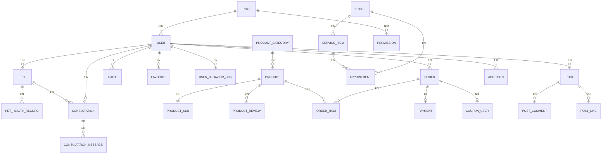

---

## 7. API 接口规约

### 7.1 设计风格

- **风格**：RESTful + 资源名词
- **前缀**：`/api/v1`
- **响应统一**：

```json
{
  "code": 0,
  "msg": "ok",
  "data": { ... },
  "traceId": "a1b2c3d4"
}
```

- **分页统一**：

```json
{
  "code": 0,
  "data": {
    "list": [...],
    "total": 100,
    "page": 1,
    "size": 10
  }
}
```

### 7.2 鉴权

- 登录后返回 `token`，前端 `Authorization: Bearer {token}`
- Sa-Token 自动解析；后端拦截器校验角色
- 商家端 / 用户端 / 管理端使用不同前缀：`/api/user/**` `/api/merchant/**` `/api/admin/**`

### 7.3 错误码段

| 段 | 含义 |
| --- | --- |
| `0` | 成功 |
| `1xxxx` | 通用错误（参数错误 10001、系统异常 10500 等） |
| `2xxxx` | 用户域（未登录 20001、密码错误 20002、账号封禁 20003 等） |
| `3xxxx` | 商品 / 服务（库存不足 30001、已下架 30002 等） |
| `4xxxx` | 订单（订单不存在 40001、状态非法 40002、已退款 40003 等） |
| `5xxxx` | 支付（余额不足 50001、支付超时 50002 等） |
| `6xxxx` | 内容 / 社区（敏感词 60001、被举报 60002 等） |
| `7xxxx` | 第三方依赖（LLM 超时 70001、ES 不可用 70002 等） |
| `9xxxx` | 后台管理（无权限 90001 等） |

### 7.4 接口幂等

写接口要求前端传 `Idempotency-Key` 头（UUID），后端 Redis 锁 60s 拦截重复请求。

### 7.5 接口清单（节选 30 条核心接口）

| Method | 路径 | 用途 | 鉴权 |
| --- | --- | --- | --- |
| POST | `/api/v1/auth/login` | 登录 | 否 |
| POST | `/api/v1/auth/sms/send` | 发送短信 | 否 |
| GET  | `/api/v1/user/me` | 当前用户 | 是 |
| GET  | `/api/v1/recommend/feed` | 首页推荐 feed | 是 |
| GET  | `/api/v1/recommend/related` | 看了又看 | 是 |
| POST | `/api/v1/consult/send` | 发起 AI 问诊 | 是 |
| GET  | `/api/v1/consult/history` | 问诊历史 | 是 |
| GET  | `/api/v1/category/tree` | 分类树 | 否 |
| GET  | `/api/v1/search` | 全局搜索 | 是 |
| GET  | `/api/v1/product/{id}` | 商品详情 | 否 |
| GET  | `/api/v1/service/{id}` | 服务详情 | 否 |
| GET  | `/api/v1/cart` | 购物车 | 是 |
| POST | `/api/v1/cart` | 添加购物车 | 是 |
| POST | `/api/v1/order` | 下单 | 是 |
| GET  | `/api/v1/order/list` | 订单列表 | 是 |
| POST | `/api/v1/pay/{orderNo}` | 支付 | 是 |
| POST | `/api/v1/pay/callback/wechat` | 微信回调 | 否 |
| GET  | `/api/v1/coupon/list` | 优惠券列表 | 是 |
| POST | `/api/v1/coupon/claim` | 领券 | 是 |
| GET  | `/api/v1/pet/list` | 宠物列表 | 是 |
| POST | `/api/v1/pet` | 新增宠物 | 是 |
| POST | `/api/v1/appointment` | 服务预约 | 是 |
| GET  | `/api/v1/community/feed` | 社区 feed | 是 |
| POST | `/api/v1/post` | 发布帖子 | 是 |
| POST | `/api/v1/post/{id}/like` | 点赞 | 是 |
| GET  | `/api/v1/article/{seoUrl}` | 知识文章 | 否 |
| GET  | `/api/v1/adoption/list` | 领养列表 | 否 |
| GET  | `/api/v1/admin/dashboard` | 后台仪表盘 | ADMIN |
| POST | `/api/v1/admin/post/audit` | 帖子审核 | ADMIN |
| POST | `/api/v1/merchant/product` | 商家发品 | MERCHANT |

完整接口在编码阶段通过 Swagger/Knife4j 自动生成文档。

---

## 8. 推荐系统设计（论文亮点）

> 这一章是论文答辩的核心差异化卖点，写得最细。

### 8.1 业务背景与挑战

首页 feed 是用户高频入口，但用户兴趣跨度大、宠物种类多元、长尾物品丰富，传统的「热门榜」很快会陷入同质化。推荐系统的目标是：

- **多样性**：让用户能持续发现新鲜内容
- **相关性**：千人千面，懂用户 + 懂宠物
- **惊喜度**：避免「信息茧房」
- **可解释性**：用户能感知到「为什么推荐这个」

### 8.2 整体架构

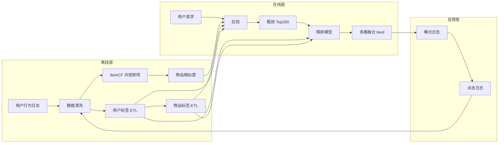

### 8.3 三类召回策略

#### 8.3.1 UserCF 用户协同过滤

**公式**：用户 u 与 v 的相似度

$$
sim(u,v) = \frac{|N(u) \cap N(v)|}{\sqrt{|N(u)| \cdot |N(v)|}}
$$

其中 N(u) 是用户 u 行为过的物品集合。

**召回**：取相似度 Top 50 用户的行为物品，加权后输出 Top 100 候选。

**实现**：MySQL 端离线算 + Redis 缓存用户相似度向量（毕业设计不引入 Spark）。

#### 8.3.2 ItemCF 物品协同过滤

**公式**：物品 i 与 j 的相似度（余弦）

$$
w_{ij} = \frac{|U(i) \cap U(j)|}{\sqrt{|U(i)| \cdot |U(j)|}}
$$

**在线**：详情页「看了又看」直接读取物品 i 的 Top 10 相似物品。

#### 8.3.3 基于内容画像

- 用户标签：`breed`（养了什么）+ `stage`（成幼老）+ `habit`（爱零食 / 爱玩具）+ `price_band`（消费力）
- 物品标签：商品类目 + 关键词 TF-IDF + 属性（适用阶段 / 适用种类）
- 余弦相似度匹配

#### 8.3.4 冷启动

新用户 / 新物品，采用：
- **热门榜**（7 天销售 top100）
- **编辑推荐**（运营配置）
- **地域策略**（同城市的热门）

### 8.4 排序模型

**轻量级 LR**（逻辑回归）：

$$
P(click) = \sigma(w^T x + b)
$$

10 个特征：
1. 用户 VipLevel
2. 用户 7 日 PV
3. 物品 CTR（历史）
4. 物品与用户标签相似度
5. 物品 freshness（距离上架天数倒数）
6. 价格匹配度
7. 转化率（商品）/ 详情完整度（帖子）
8. 多样性惩罚（同 feed 已出现次数）
9. 时段（白天 vs 晚间 → 不同权重）
10. push 召回 flag（特定召回通道加权）

训练数据：近 7 天曝光 / 点击日志。

> **答辩亮点**：明确写出「为什么不直接用深度模型」——毕业设计阶段数据量不足以训练，可解释性差；LR 足以验证业务效果。

### 8.5 多路融合

```
最终 feed = α × 内容召回 + β × ItemCF + γ × UserCF + δ × 热门 + ε × 地域
α + β + γ + δ + ε = 1
```

默认权重 `[0.4, 0.25, 0.15, 0.15, 0.05]`，通过离线 A/B 实验在管理后台可调。

### 8.6 评估指标

| 指标 | 公式 | 目标 |
| --- | --- | --- |
| CTR | 点击 / 曝光 | ≥ 8% |
| CVR | 转化 / 点击 | ≥ 3% |
| 多样性 | 1 - sim_avg | ≥ 0.5 |
| 惊喜度 | 推荐中物品的平均 popularity rank | Top30% |

论文里设计 2 组对照实验：
- 实验 1：热门榜 vs 多路融合
- 实验 2：加入内容画像 vs 不加入

### 8.7 工程实现（毕业设计务实版）

| 组件 | 技术 |
| --- | --- |
| 离线计算 | Spring Boot `@Scheduled` + MyBatis-Plus 聚合 SQL，每天 02:00 跑 |
| 相似度缓存 | Redis Hash，`key=item:sim:{id}`，`value=top10` |
| 在线召回 | Controller 内同步调用，Redis 查询平均 5ms |
| 日志落盘 | 异步线程池 + 主键批量 insert，避免请求阻塞 |
| A/B 实验 | 用 cookie hash 桶分用户，分流比例 5% 对照组 vs 95% 实验组 |

---

## 9. AI 智能问诊设计（论文亮点）

> 第二核心差异化卖点。

### 9.1 业务背景

新手宠物主遇到宠物突发不适，常因判断不了轻重缓急而纠结是否送医。AI 智能问诊定位是：**「不替代医生，但告诉你该怎么做」**——分级建议 + 引导线下就医 + 关联商品购买。

### 9.2 技术选型

| 项 | 选型 | 理由 |
| --- | --- | --- |
| LLM | 智谱 GLM-4 / 通义千问 Qwen / DeepSeek 任选其一 | 国内合规、低成本、API 简洁 |
| ASR | 科大讯飞（沙箱） | 用户语音快速录入 |
| OCR | 百度 OCR（沙箱） | 图片识别 |
| 知识库 | 内置 JSON 文件 + Elasticsearch | 简单可控 |
| 限流 | Redis 滑动窗口 | 防止刷量 |

### 9.3 系统流程

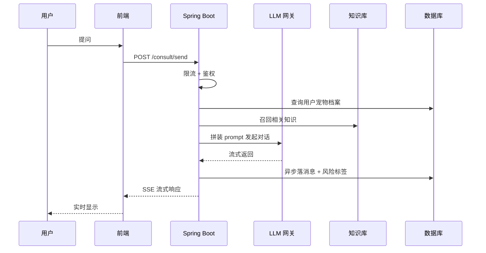

### 9.4 Prompt 工程

系统 Prompt（节选）：

```
你是 PetMate 的宠物 AI 健康助手「毛毛医生」。
你的角色：基于知识库为用户宠物的常见健康问题提供参考建议。
你的边界：
1. 不开具处方药物，只描述可能的疾病方向
2. 危急场景必须先告知「立即送医」并给出最近的宠物医院地址
3. 多轮对话中注意结合上下文，逐步问清关键信息
4. 回答使用通俗中文，控制在 200 字以内
宠物档案：
- 名字：{pet.name}
- 种类：{pet.category}
- 年龄：{age}
- 体重：{weight}kg
- 历史疾病：{pet.health_records}
对话历史：
{history}
当前问题：{user_input}
请输出：
1. 紧急度评级（危急/普通/良好）
2. 可能的方向（不超过 3 个）
3. 建议下一步（立即送医 / 居家观察 / 用药建议 / 调整饮食）
4. 相关知识引用
```

### 9.5 风险分级

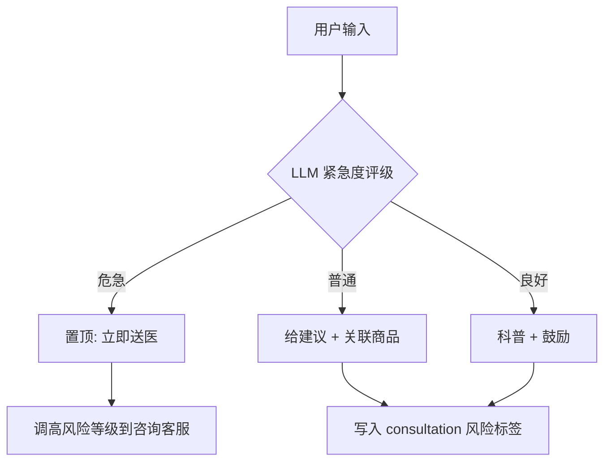

### 9.6 RAG 实现

- 知识库结构：

```json
{
  "id": "cat_vaccine_001",
  "title": "猫咪疫苗接种完全指南",
  "species": ["cat"],
  "stage": ["kitten"],
  "content": "...",
  "keywords": ["疫苗", "猫三联", "狂犬"],
  "source": "AAFP 2024"
}
```

- 召回：ES 全文检索 + 关键词高亮
- 拼装：取 Top 3 知识拼入 LLM Prompt 的「关联知识」字段

### 9.7 会话存储与历史

- `t_consultation`：会话主表
- `t_consultation_message`：消息明细，按 `consultation_id` + `created_at` 时序
- 历史会话列表查询 LRU 缓存最近 20 条

### 9.8 限流与兜底

| 策略 | 阈值 |
| --- | --- |
| 用户限频 | 6 次 / 分钟 |
| IP 限频 | 30 次 / 分钟 |
| 模型超时 | 15s 兜底返回「请稍后再试」 |
| 敏感词 | 命中即拒绝并记录（狗肉交易等） |

### 9.9 数据脱敏

- 手机号 / 身份证号正则替换为 `***`
- 不收集宠物主人真实姓名（仅昵称）
- 24h 后原始对话日志归档到脱敏库

### 9.10 成本与监控

- 接入 LLM 单次问答平均 Token：300 输入 + 500 输出
- 单次成本：约 0.01 元（智谱 GLM-4 Flash 价位）
- 监控：Sentinel 熔断，连续 5 次失败切换备用厂商

---

## 10. 非功能性需求

### 10.1 性能

| 接口类型 | P95 时延 | QPS | 备注 |
| --- | --- | --- | --- |
| 静态资源（OSS + CDN） | < 100ms | 1000+ | 边缘缓存 |
| 首页 feed | < 500ms | 200 | Redis 缓存 |
| 商品搜索 | < 400ms | 100 | ES 倒排 |
| 通用查询接口 | < 300ms | 500 | 索引齐全 |
| 写接口（下单 / 支付回调） | < 800ms | 100 | 事务 |
| AI 问诊首字 | < 1.5s | - | 用户体验线 |
| AI 问诊全答 | < 8s | - | 流式 |

### 10.2 安全

按 OWASP Top 10 (2021) 自查：

| 风险 | 加固方案 |
| --- | --- |
| A01 越权 | Sa-Token `@SaCheckRole` + 数据权限注解 |
| A02 加密 | 密码 BCrypt、手机号 AES、字段级加密 |
| A03 注入 | MyBatis-Plus 参数化 + 显式 ES query DSL |
| A04 不安全设计 | 风险评审、用户故事三件套 |
| A05 配置错误 | Spring Boot Actuator 收敛、敏感配置走 Vault |
| A06 组件漏洞 | 定期依赖扫描、Spring Boot 升级到最新稳定版 |
| A07 身份认证 | JWT + 短期 access + 长期 refresh |
| A08 数据完整性 | HMAC 签名支付回调、Idempotency-Key 头 |
| A09 日志监控 | ELK 集中日志、Prometheus 指标 |
| A10 SSRF | 出站白名单 |

### 10.3 可用性

- 目标：4 个 9（99.99%），月故障时间 < 43 min
- 措施：
  - 多级降级（首页：推荐不行 → 降级热门榜；热门榜不行 → 降级编辑推荐）
  - 限流 Sentinel
  - 灰度发布

### 10.4 可观测性

- **链路追踪**：traceId 贯穿网关 → Controller → Service → DB
- **日志**：Logback + ELK，按 traceId 查询
- **指标**：Micrometer + Prometheus + Grafana
- **告警**：5xx > 0.1% 触发企业微信通知（演示可省略实装）

### 10.5 兼容性（端形态与响应式，关键）

#### 10.5.1 端形态总览

PetMate 是 **纯浏览器 Web 端**，不开发原生 App（不做小程序、不做 iOS/Android 客户端）。所有用户/商家/管理员均通过浏览器访问。

| 端 | 形态 | 适配要求 |
| --- | --- | --- |
| 用户端 | **响应式 Web（桌面优先 + 移动浏览器自适应）** | 一套 Vue 代码覆盖 PC、平板、手机三类视口 |
| 商家端 | **PC 为主** | 手机浏览器可正常阅读，复杂交互/编辑在手机上仅显示引导提示 |
| 管理后台 | **仅 PC 桌面端**（≥1280px 优化） | ≤1024px（含手机/平板）访问展示「请使用桌面浏览器」 |

#### 10.5.2 视口断点

| 断点 | 视口宽度 | 列数 | 典型设备 |
| --- | --- | --- | --- |
| 桌面 | ≥1024px | 3-4 列 | PC、笔记本 |
| 平板 | 768~1024px | 2 列 | iPad、Android 平板 |
| 手机 | ≤768px | 单列 + 底部 Tab | 手机浏览器、PWA |

#### 10.5.3 适配技术方案

- **核心**：PostCSS + `postcss-px-to-viewport`
- **设计稿**：1920px 宽；构建后 `100vw` = 设计稿 1920px，CSS 写 `px` 即可
- **替代选项**：vw/vh 方案（手动 rem 或 :root 字号）；不建议媒体查询堆断点
- **1px 边框**：`transform: scaleY(0.5)` + `min-device-pixel-ratio: 2` 条件
- **图片**：`srcset` 多倍图 + `loading="lazy"` + `object-fit: cover`

#### 10.5.4 浏览器兼容矩阵

| 浏览器 | 最低版本 | 是否响应式适配 |
| --- | --- | --- |
| Chrome（桌面 / Android） | 最近 2 个稳定大版本 | ✅ |
| Edge（Chromium 内核） | 最近 2 个稳定大版本 | ✅ |
| Safari（macOS / iOS） | 14+ | ✅ |
| Firefox（桌面） | 最近 2 个稳定大版本 | ✅（次要） |
| 微信内置浏览器 | - | ✅（避免触发外链拦截） |
| 360 极速 / QQ 浏览器 | Chromium 内核 | ✅ |

#### 10.5.5 移动浏览器专项

- 按钮最小可点击区 **44×44px**（HIG）
- 表单输入框 `font-size ≥ 16px`（避免 iOS 自动缩放）
- 列表使用 `-webkit-overflow-scrolling: touch`
- 适配横竖屏切换
- 不引入 `position: fixed` 的悬浮输入法兼容问题，必要时改用 `sticky`
- `viewport-fit=cover` 适配刘海屏 / 安全区域
- 表单 `inputmode` 按场景选 `numeric` / `email` / `tel` / `decimal`

#### 10.5.6 后端兼容性

| 类别 | 兼容目标 |
| --- | --- |
| JDK | **21 LTS**（启用虚拟线程 + Sequenced Collections） |
| Spring Boot | 3.3.x（官方推荐 JDK 21） |
| MySQL | 8.0+ |
| Redis | 7.0+ |
| Elasticsearch | 8.x |
| RabbitMQ | 3.13+ |
| Node.js（构建环境） | 18 LTS |

### 10.7 JDK 选型说明（v1.2 升级）

| 对比项 | JDK 17 LTS | **JDK 21 LTS（采用）** |
| --- | --- | --- |
| 发布时间 | 2021-09 | 2023-09 |
| 主流支持到期 | 2026-10（临近） | 2026-09（仍可用） → 2028-09（扩展支持） |
| 虚拟线程 | 预览 | **正式（JEP 444）** |
| Sequenced Collections | ✗ | ✓ |
| Pattern Matching for switch | 预览 | **正式（JEP 441）** |
| 字符串模板 | ✗ | 预览（JEP 459） |
| Spring Boot 官方推荐 | 兼容 | **首选** |

**采用 JDK 21 的理由**：

1. **虚拟线程**：AI 问诊需要并发调多家 LLM 网关、推荐系统要并发查多路召回，虚拟线程让高并发场景下不再依赖复杂线程池调参，**论文可写"采用 JDK 21 虚拟线程支撑高并发推荐召回"的实验小节**
2. **语法糖**：业务代码更精炼（`switch` 模式匹配、`SequencedMap.getFirst()/getLast()`、`Collections.getOrDefault()` 优化）
3. **先进性加分项**：2026 年 JDK 21 已普及，作为毕业设计的"技术栈先进"佐证
4. **Spring Boot 3.3.x 官方推荐 JDK 21**，组合稳定

**对项目的影响**：

- `pom.xml` 设定 `<java.version>21</java.version>`
- AI 问诊 / 推荐 / 秒杀三大并发场景启用 `Executors.newVirtualThreadPerTaskExecutor()`
- 老依赖（如部分三方 SDK）需验证 JDK 21 兼容性；Sa-Token、MyBatis-Plus、Knife4j 等主流组件均已支持

### 10.6 可维护性

- 代码规范：Checkstyle + Spotless 提交门禁
- 单测覆盖率：核心 service 层 ≥ 70%
- 接口文档：Knife4j 自动生成 + 维护示例

---

## 11. 技术选型与架构图

### 11.1 架构风格选择

| 候选 | 优点 | 缺点 | 决策 |
| --- | --- | --- | --- |
| **单体应用** | 简单、易调试、易部署 | 扩展粒度粗 | ✅ 采用 |
| 微服务 (Spring Cloud) | 服务拆分、可独立扩容 | 复杂度高、学习曲线陡 | ❌ 毕业设计过度工程 |
| 模块化单体 (Spring Modulith) | 兼顾拆分与简单 | 生态新 | ❌ 资料少 |

### 11.1.1 前端端形态选择

| 候选 | 优点 | 缺点 | 决策 |
| --- | --- | --- | --- |
| **响应式 Web 单 SPA（Vue 3 一套代码）** | 工作量小、上手快、毕设展示完整 | 不适合复杂原生交互 | ✅ 用户端采用 |
| 用户端 PC / H5 双工程 | 各端可深度优化 | 工作量翻倍 | ❌ 过度投入 |
| 桌面原生（Electron） | 强交互 | 与「浏览器访问」约束冲突 | ❌ |
| 移动原生 / 小程序 | 移动端体验好 | 与「浏览器访问」约束冲突 | ❌ 不开发 |
| PWA 渐进式 Web App | 可添加到桌面 / 主屏 | 国内浏览器对 PWA 支持参差 | ⚠️ 可选，后续可演进 |

**结论**：用户端采用 **Vue 3 + Vite + TypeScript + Element Plus + `postcss-px-to-viewport` 单 SPA** 一套代码，**桌面优先 + 移动浏览器自适应**，覆盖 PC、平板、手机三类视口。商家端、管理后台为 PC 专用，与用户端共享同一套前端工程基础与组件库。

### 11.2 系统架构图

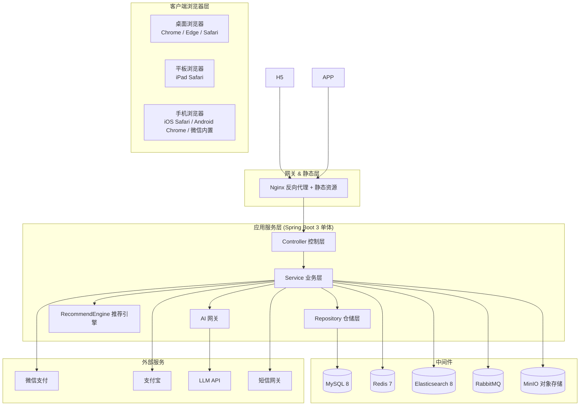

### 11.3 后端技术栈

| 层 | 选型 | 版本 | 理由 |
| --- | --- | --- | --- |
| 基础 | JDK | **21 LTS** | 启用虚拟线程（JEP 444）大幅提升并发能力；Sequenced Collections 简化集合处理；2026 年已普及 |
| 框架 | Spring Boot | 3.3.4 | 最新稳定，官方推荐 JDK 21 |
| ORM | MyBatis-Plus | 3.5.7 | 单表免写 SQL，开发快 |
| 鉴权 | Sa-Token | 1.45 | 比 Spring Security 轻 |
| 缓存 | Redis | 7.x | 热点缓存、限流 |
| 搜索 | Elasticsearch | 8.x | 全文检索 |
| MQ | RabbitMQ | 3.13 | 异步、削峰 |
| 对象存储 | MinIO | - | 兼容 S3 协议 |
| 文档 | Knife4j | 4.x | Swagger 增强 |
| 工具 | Hutool / Lombok / MapStruct | - | 提效 |
| 安全 | jasypt / Spring Crypto | - | 配置加密 |

### 11.4 前端技术栈

| 层 | 选型 | 版本 | 理由 |
| --- | --- | --- | --- |
| 框架 | Vue | 3.4 | Composition API |
| 构建 | Vite | 5 | 启动快 |
| 语言 | TypeScript | 5 | 类型友好 |
| UI | Element Plus | 2.x | 组件丰富 |
| 状态 | Pinia | 2.x | 替代 Vuex |
| 路由 | Vue Router | 4 | |
| HTTP | Axios | 1.x | 二次封装拦截器 |
| 图表 | ECharts | 5 | 数据大屏 |
| 富文本 | WangEditor / Tiptap | - | 内容编辑 |
| 工具 | VueUse / Day.js | - | composable |
| **响应式适配** | **postcss-px-to-viewport** | **1.1.1** | **桌面优先 + 移动浏览器自适应** |
| 布局辅助 | @vueuse/core 响应式 composable | - | useMediaQuery / useWindowSize |
| 触控 | VueUse onClickOutside / useScroll | - | 移动端体验 |
| CSS 预处理器 | Sass / SCSS | 1.78+ | 工程化样式 |

### 11.4.1 前端目录结构（响应式友好）

```
petmate-web-user/
├── public/
├── src/
│   ├── views/              # 页面视图
│   │   ├── home/
│   │   ├── product/
│   │   ├── community/
│   │   ├── consult/
│   │   └── user/
│   ├── components/         # 通用业务组件
│   │   ├── responsive/     # ★响应式组件：MobileOnly / DesktopOnly / ResponsiveContainer
│   │   ├── product/        # ProductCard / ProductGrid（按视口自动 1-4 列）
│   │   └── layout/         # AppHeader / MobileDrawer / BottomTabBar
│   ├── composables/        # Composition API 抽象
│   │   ├── useViewport.ts  # ★视口判断
│   │   ├── useRequest.ts
│   │   └── useUser.ts
│   ├── stores/             # Pinia
│   ├── router/             # 路由 + 全局守卫
│   ├── api/                # axios 二次封装
│   ├── utils/              # 工具
│   ├── styles/
│   │   ├── variables.scss  # 全局 SCSS 变量
│   │   ├── mixin.scss      # @include respond-to(tablet/mobile)
│   │   └── reset.scss
│   ├── types/              # 类型定义
│   ├── App.vue
│   └── main.ts
├── postcss.config.js       # ★postcss-px-to-viewport 配置
├── vite.config.ts
└── tsconfig.json
```

### 11.4.2 PostCSS 适配配置示例

```js
// postcss.config.js
module.exports = {
  plugins: {
    'postcss-px-to-viewport': {
      unitToConvert: 'px',
      viewportWidth: 1920,         // 设计稿宽度
      unitPrecision: 5,
      propList: ['*'],
      viewportUnit: 'vw',
      fontViewportUnit: 'vw',
      selectorBlackList: ['.no-vw'],   // 不转换的 class 前缀
      minPixelValue: 1,
      mediaQuery: false,
      replace: true,
      exclude: [/node_modules/]
    }
  }
}
```

### 11.4.3 响应式组件示例

```vue
<!-- components/responsive/ResponsiveContainer.vue -->
<script setup lang="ts">
import { computed } from 'vue'
import { useViewport } from '@/composables/useViewport'

const { isMobile, isTablet, isDesktop } = useViewport()
const columns = computed(() => isMobile.value ? 1 : isTablet.value ? 2 : isDesktop.value ? 4 : 3)
</script>

<template>
  <div :style="{ gridTemplateColumns: `repeat(${columns}, 1fr)` }" class="grid">
    <slot />
  </div>
</template>
```

```vue
<!-- composables/useViewport.ts -->
import { ref, onMounted, onUnmounted } from 'vue'
export function useViewport() {
  const width = ref(window.innerWidth)
  const isMobile = computed(() => width.value <= 768)
  const isTablet = computed(() => width.value > 768 && width.value < 1024)
  const isDesktop = computed(() => width.value >= 1024)
  const onResize = () => (width.value = window.innerWidth)
  onMounted(() => window.addEventListener('resize', onResize))
  onUnmounted(() => window.removeEventListener('resize', onResize))
  return { width, isMobile, isTablet, isDesktop }
}
```

### 11.4.4 路由守卫：移动端屏蔽后台

```ts
// router/guard.ts
router.beforeEach((to, _from, next) => {
  if (to.path.startsWith('/admin') && window.innerWidth < 1024) {
    return next({ name: 'AdminUnsupported' })  // 提示「请使用桌面浏览器」
  }
  if (to.path.startsWith('/merchant') && window.innerWidth < 768) {
    return next({ name: 'MerchantReadonlyTip' })  // 提示手机上仅可阅读
  }
  next()
})
```

### 11.5 部署与运维

| 组件 | 方案 |
| --- | --- |
| 容器化 | Docker + Docker Compose |
| 反向代理 | Nginx 1.24 |
| CI/CD | GitHub Actions / Jenkins（演示可省略） |
| 监控 | Prometheus + Grafana（可选） |
| 日志 | ELK（可选） / 简易文件 |
| Web 服务器 | Spring Boot 内置 Tomcat |

### 11.6 目录结构

```
PetMate/
├── petmate-backend/              # Spring Boot 后端
│   ├── petmate-common/           # 公共工具（异常、常量、工具类）
│   ├── petmate-auth/             # 登录、权限
│   ├── petmate-user/             # 用户域
│   ├── petmate-pet/              # 宠物域
│   ├── petmate-product/          # 商品域
│   ├── petmate-trade/            # 交易域
│   ├── petmate-pay/              # 支付域
│   ├── petmate-service/          # 服务预约域
│   ├── petmate-consult/          # AI 问诊域
│   ├── petmate-community/        # 社区域
│   ├── petmate-content/          # 知识 / 领养
│   ├── petmate-marketing/        # 营销
│   ├── petmate-recommend/        # 推荐系统
│   ├── petmate-admin/           # 后台管理
│   └── petmate-app/             # 主启动模块
├── petmate-web-user/             # 用户端 Vue
├── petmate-web-merchant/         # 商家端 Vue
├── petmate-web-admin/            # 管理后台 Vue
├── docker-compose.yml
└── README.md
```

---

## 12. 里程碑与 WBS

### 12.1 14 周进度甘特图（文字版）

| 周次 | 主题 | 交付物 | 风险 |
| --- | --- | --- | --- |
| **W1** | 需求与文档 | 产品 PRD 全部章节定稿；论文章节大纲确定 | 需求蔓延 → 锁定 v1.0 范围 |
| **W2** | 设计与脚手架 | 库表 ER + 后端多模块 Maven 骨架 + 前端 3 套 Vue 工程 | 环境不通 → 提前探路 |
| **W3** | 基础能力 | 用户 / 角色 / 权限 / Sa-Token / Knife4j | 鉴权坑 → 参考官方 demo |
| **W4** | 宠物档案 | 宠物 CRUD + 成长日记 + 健康提醒 | |
| **W5** | 商品商城 | 商品 / SKU / 分类 / 上下架 / 搜索（ES） | ES 启动慢 → 用 compose pre-pull |
| **W6** | 订单交易 | 购物车 + 下单 + 支付 + 退款状态机 | 状态机复杂度 → 先跑通主流程 |
| **W7** | 营销 + 钱包 | 优惠券 / 积分 / 秒杀 | 秒杀锁竞争 → Redisson |
| **W8** | 预约服务 | 美容 / 训练 / 寄养 + 排班 | 排班数据模型 |
| **W9** | AI 智能问诊 | LLM 接入 + Prompt + RAG + 限流 | API 配额 → 申请免费额度 |
| **W10** | 社区 + 内容 | 帖子 / 评论 / 知识 / 领养 | 视频存储 → 转码费时 |
| **W11** | 推荐系统 | UserCF + ItemCF + LR 排序 | 数据稀疏 → 加内容画像 |
| **W12** | 后台 + 看板 | 22 个后台页 + 商家端 + ECharts 大屏 | |
| **W13** | 测试与部署 | 单测 / 接口测 / 压测 / Docker 部署 | |
| **W14** | 论文与答辩 | 全文撰写 + PPT + 演示视频 | 提前演练 3 次 |

### 12.2 验收标准

每个模块交付必须满足：

- 自测覆盖率：service 层 ≥ 70%
- 接口文档同步更新（Knife4j）
- 性能对照上文 [10.1 性能](#101-性能) 表
- 至少一个核心功能走通端到端冒烟
- 关键代码有注释（含论文引用）

### 12.3 风险与应对

| 风险 | 概率 | 影响 | 应对 |
| --- | --- | --- | --- |
| 第三方 LLM 不可用 | 中 | 中 | 准备 2 家厂商自动切换 |
| 数据稀疏导致推荐无效 | 高 | 中 | 加内容画像兜底 |
| 前端时间不足 | 高 | 高 | 优先用户端，商家端简化 |
| 论文查重 / 抽检 | 中 | 高 | 自己写段落，避免大段引用 |
| 答辩前崩溃 | 低 | 高 | 每天压测一次 + 准备演示视频 |

---

## 13. 论文-章节对照表

> 直接把对应内容粘到毕业论文。注意论文中需补充引言与学术化措辞。

| 毕业论文章节 | 主要事实来源（本 PRD 章节） |
| --- | --- |
| 第 1 章 绪论（背景 / 意义 / 目标） | [1.1](#11-产品愿景) / [1.2](#12-目标用户细分) |
| 第 2 章 相关技术介绍 | [11.2](#112-后端技术栈) / [11.3](#113-前端技术栈) |
| 第 3 章 需求分析 | [3 功能模块拆解](#3-功能模块拆解) + [4 用户旅程地图](#4-用户旅程地图) + [10 非功能性需求](#10-非功能性需求) |
| 第 4 章 总体设计 | [11.2 系统架构图](#112-系统架构图) + [5 信息架构与页面清单](#5-信息架构与页面清单) + [7 API 接口规约](#7-api-接口规约) |
| 第 5 章 数据库设计 | [6 数据库设计](#6-数据库设计) |
| 第 6 章 详细设计与实现 | [8 推荐系统设计](#8-推荐系统设计论文亮点) + [9 AI 智能问诊设计](#9-ai-智能问诊设计论文亮点) |
| 第 7 章 系统测试 | [10.1 性能](#101-性能) + [10.3 可用性](#103-可用性) + [12.2 验收标准](#122-验收标准) |
| 第 8 章 总结与展望 | 整篇回顾 + 后续规划（多端、O2O、信用体系） |

---

## 附录 A：与用户的开放式决策点（待编码阶段确认）

> 以下为不影响 PRD 主线的小决策，编码阶段择优即可：

- [x] **端形态**：纯浏览器 Web 端，用户端响应式（桌面优先 + 移动浏览器自适应），商家端/后台为 PC 专用（**v1.1 已确认**）
- [ ] 真实环境对接哪家大模型？（默认推荐 **智谱 GLM-4 Flash**，1 元 / 百万 token）
- [ ] 是否启用 Redis 集群？（演示数据量无需）
- [ ] 是否集成 WebSocket 实时消息？（社区评论可选简化）
- [ ] 是否使用 Vue 3 SSR / Nuxt？（不推荐，纯 CSR 即可）
- [ ] 是否实现完整 Docker Compose 部署？（论文演示强力推荐）
- [ ] 是否启用 PWA（可安装到桌面 / 主屏）？（可选，后续可演进）

---

## 附录 B：版本记录

> **v1.0 · 2026-07-17** · 完成 13 节完整 PRD，覆盖 15 模块 + 68 页面 + 30 表 + 60+ 接口 + 2 大亮点章节
> **v1.1 · 2026-07-17** · 追加「端形态与响应式适配」专项：
>   - 0.3 新增端形态决策（响应式 Web + PC 优先 + 移动浏览器自适应）
>   - 0.4 新增 ★7 答辩亮点（响应式适配）
>   - 新增 **5.0 端形态与响应式策略** 节（含断点表、技术方案、关键页面策略、触控优化）
>   - **10.5 兼容性** 改写为端形态专项（端形态总览、断点、技术方案、浏览器兼容矩阵、移动浏览器专项、后端兼容）
>   - 11.1.1 新增前端端形态选择决策表
>   - 11.2 架构图客户端层更新为「客户端浏览器层」（桌面/平板/手机浏览器）
>   - 11.4 前端技术栈新增 `postcss-px-to-viewport 1.1.1`、SCSS、响应式辅助工具
>   - **11.4.1~11.4.4** 新增前端响应式目录结构、PostCSS 配置示例、响应式组件示例、路由守卫示例
>   - 附录 A 关闭端形态决议项，新增 PWA 开放项
> **v1.2 · 2026-07-17** · JDK 17 → JDK 21 LTS 升级：
>   - 0.3 后端栈 `JDK 17` 改为 `JDK 21 LTS`
>   - **10.5.6** 后端兼容性表 JDK 行改为「21 LTS（启用虚拟线程 + Sequenced Collections）」
>   - 11.3 后端技术栈表 JDK 行改为「21 LTS」，理由新增「启用虚拟线程（JEP 444）大幅提升并发能力」
>   - **新增 10.7 JDK 选型说明**：JDK 17 vs JDK 21 对比表 + 4 条采用理由（虚拟线程、语法糖、先进性加分、Spring Boot 3.3 推荐）+ 对项目的影响说明（pom 配置、并发场景启用虚拟线程执行器）
> **作者**：产品经理视角 · 适用对象：计算机专业本科毕业设计
